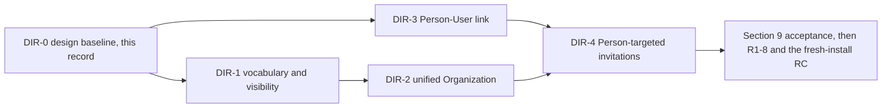
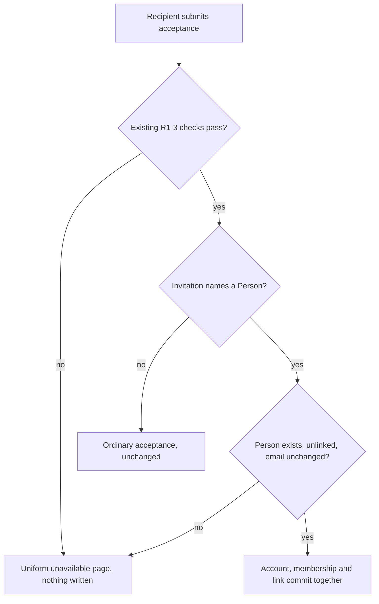

# Release 1.0: DIR-0 Directory, identity and Organization coherence (architecture resolution and work-package specifications)

**Status:** **design approved by the owner (2026-11-17); documentation only.** Nothing described here as DIR-1 to DIR-4 is implemented, and none of those packages is authorized to start: each needs its own explicit owner authorization. Written against `main` at `e0faac0` (PR #70; the tree is identical to the audited revision `94ae904`). No application code, migration, test, permission, seeder or environment was changed by DIR-0. Release 0.9 staging is untouched.

**What this record is.** The model is decided in [ADR-010](../architecture/adr/ADR-010-directory-identity-organization-model.md) and is not repeated here. This record holds what an implementer needs: the ruling register, the verified current state, the terminology, the four work packages with their contracts, invariants, tests and review gates, the end-to-end acceptance scenario and the release gates.

**One-sentence goal.** Before Release 1.0, an operator onboards an external Organization and its People through one coherent Directory experience, and a Person who is invited to the portal becomes one identity (a Person linked to a User), without any new access being granted to anyone.

## 1. Owner rulings (2026-11-17)

| # | Ruling | Specified in |
|---|---|---|
| R1 | Directory, Person–User identity linking, invitation integration and coherent Organization administration are **prerequisites of Release 1.0**. This supersedes the 2026-11-12 deferral for these capabilities only | [roadmap](./product-roadmap.md#release-1-sequence), [release notes](./release-1.0-notes.md) |
| R2 | The workspace stays **Directory**; it serves external relationships; operators need no Person record | ADR-010, decision 1 |
| R3 | Person and User are independent records with an optional one-to-one link; a Person may have no Organization and no account; a User may have no Person | ADR-010, decisions 4 and 5 |
| R4 | An operator may create a Person from a User, or invite a User from a Person. A Person for an operator account only on explicit request | sections 7 and 8 |
| R5 | A manual link needs an active operator holding `portal.operator`, `crm.manage` **and** `users.manage`; it is an audited assertion with a required reason, never "verified identity"; the three origins of a link stay distinguishable | ADR-010, decisions 5 and 8; section 7 |
| R6 | Names and emails of Person and User stay independently authoritative | ADR-010, decision 3 |
| R7 | Acceptance of a Person-targeted invitation is atomic: account, membership and link together, or nothing. Never completed silently without the link | section 8 |
| R8 | Editing a Person's email invalidates their pending Person-targeted invitation, with a clear warning and a simple reissue | section 8 |
| R9 | One coherent Organization experience over the existing two tables; **Directory is authoritative for the organization name**, propagated transactionally with an audit entry; a Directory profile that has a portal organization cannot be deleted | ADR-010, decisions 2 and 3; section 6 |
| R10 | **System → Organization access** stays as an administrative index that links into the unified Organization experience. Profile repair is authorized, audited, idempotent and protected against duplicate creation | section 6 |
| R11 | The company-specific contact structure is transitional. Do not encourage duplicate People; document the limitation and the path to multiple affiliations; do not build multi-affiliation management now | ADR-010, "Multiple affiliations" |
| R12 | A link never grants authorization and never exposes Directory information. Membership, approval, support-designation and tenant-isolation guarantees are preserved | section 4 |
| R13 | Physical consolidation of `crm_companies` and `organizations`, advanced CRM features and modal cross-record interfaces are **outside** the required scope | ADR-010, "Physical consolidation"; section 13 |

Everything else in this record is the design that implements those rulings; where it goes beyond a ruling it says **Recommendation**.

## 2. Verified current state

Read from code at `e0faac0`. Paths are under `src/`.

**Navigation and labels.** The Directory workspace offers "People" → `crm.contacts.index`, "Organizations" → `crm.companies.index` and "Portal access" → `organizations.index` (`app/Shared/Navigation/NavigationBuilder.php:329-359`). The pages disagree with the navigation: the contacts pages are titled "Contacts", the companies pages "Companies", and the `organizations` index "Organizations" with the subtitle "Client organizations promoted from the CRM." (`resources/views/organizations/index.blade.php:8-9`). The action that creates a portal organization is labelled "Promote to Org" (`resources/views/crm/companies/show.blade.php:22`).

**Organization records.** `crm_companies.organization_id` is nullable, unique, `ON DELETE SET NULL`. `CrmService::promoteToOrganization` is the only code that creates an `organizations` row; it copies the company name once, sets `owner_id` to the promoting operator and attaches that operator as an `admin` member (`app/Services/CrmService.php:167-191`). No route updates an organization's name, and `updateCompany` writes only `crm_companies`, so the two names can diverge. `deleteCompany` refuses a company whose organization is a partner or is managed, or that has project links; any other promoted company can be deleted, leaving a portal organization with no profile (`CrmService.php:60-119`). `organizations:preflight` reports such an organization as a **warning** (`app/Services/OrganizationPreflight.php:38-43`). `DevSeeder` creates organizations with no company.

**Managing relationship.** Stored on `organizations` (`managed_by_organization_id`, `can_manage_customers`), written only by `OrganizationRelationships`, read for authorization by nothing except `PartnerSupportAccess` (which also needs a per-member designation). It is shown only in the relationship panel of `organizations.show`, and only to an actor who passes `manageRelationships`.

**People.** `crm_contacts` has `crm_company_id` (nullable, `SET NULL`), names, `email` (nullable, indexed, **not unique**), phone, job title, notes and `created_by`. Creation and editing accept no company (`app/Http/Controllers/Crm/ContactController.php:47`), and the views handle one. **There is no reference from a contact to a user** in any column, relation or query. A contact is tenant-scoped through its company (`app/Shared/Scopes/OrganizationThroughCompanyScope.php`), so a contact without a company is visible to operators only. Contact create, update and delete write no activity-log entry; delete is unguarded.

**Accounts.** An account is created only by `operator:bootstrap` or by accepting an organization invitation; there is no admin "create user" and public registration is off. System → Users lists every account, unscoped (`app/Http/Controllers/Admin/UserController.php:22-33`), but shows no membership; the user page shows only the invitation an account joined by. A user can change their own email address with no re-verification (`app/Actions/Fortify/UpdateUserProfileInformation.php:35-42`). SSO finds an account by provider subject only, never by email.

**Invitations.** `OrganizationInvitations::issue(Organization, string $email, User $actor)` takes a typed address, refuses one that already has an account, and binds the invitation to one organization (`app/Services/OrganizationInvitations.php:178-247`). Acceptance locks the issuer's user row (shared), the organization row and the invitation row, then creates the account, the `member` membership and marks the invitation accepted (`:371-457`). The documented global lock order is: the `users.manage` permission row → user rows → organization rows (ascending id) → invitation rows (ascending id) → the rest ([R1-3, section 9](./release-1.0-r1-3-organization-invitations.md#9-concurrency-and-security-invariants-proposed-revised)).

**Two administration surfaces.** Suspension and platform roles are on the user page (`users.manage`). Membership, organization role, approval, invitations and support designations are on `organizations.show` (`portal.operator` and `crm.manage`). Member rows do not link to the user page.

**Permissions shown but unused.** `org.admin`, `org.invite`, `org.manage_roles`, `crm.view`, `crm.create`, `crm.admin` and the `*.view_org` permissions are in the catalogue and are checked by no code; the role editor renders them as ordinary checkboxes.

**Test tooling.** `e2e:cleanup-invitees` refuses an account that any foreign key references other than the four kinds it removes, discovering those keys from the schema at run time (`app/Console/Commands/CleanupE2eInvitees.php:347-356`).

## 3. Terminology

DIR-1 applies this glossary to every operator-visible string and adds the rule to `AGENTS.md`, as R1-7 did for service requests. Technical names do not change.

| User-facing term | Means | Technical name (unchanged) |
|---|---|---|
| **Directory** | the workspace | `crm.*` routes, `crm.manage`, `resources/views/crm` |
| **Person**, **People** | a Directory record of a human | `CrmContact`, `crm_contacts`, `crm.contacts.*` |
| **Organization** | the one conceptual entity (profile and portal access together) | `CrmCompany` / `crm_companies` and `Organization` / `organizations` |
| **Portal access** | the state and the section of an Organization that holds membership, invitations, approval, support designations and the managing relationship | `organizations`, `organizations.show` |
| **Enable portal access** | creating the portal organization for a profile | `promoteToOrganization`, `crm.companies.promote` |
| **Member** | an account with a membership of an Organization | `organization_members` |
| **Account**, **User** | an authenticated identity (System) | `User`, `users` |
| **Linked account** / **Directory person** | the other side of a Person–User link | `crm_contacts.user_id` |
| **Partner**, **Managed by**, **Managed customers** | the administrative managing relationship (unchanged wording) | `can_manage_customers`, `managed_by_organization_id` |
| **Organization access** | the System index of portal organizations | `organizations.index` |
| **Directory profile** | only where the two records must be told apart: the missing-profile notice and its repair | `crm_companies` |

Operator-visible text does not say "Company", "CRM", "Promote" or "Org", and does not call a Directory record a "Contact". "Contact" keeps its R1-5 meaning in partner support (the customer contact a request is raised for, who is always a User).

## 4. Package sequence and shared invariants

DIR-2 and DIR-3 are independent of each other and may proceed in parallel. DIR-4 needs DIR-3 (the link and its service) and DIR-2 (the Organization page and its portal status are where a Person-targeted invitation is issued and observed). Each package is one pull request.

**Invariants every package keeps (tests in every package prove the ones it could affect):**

| # | Invariant |
|---|---|
| S1 | No new permission, so no `roles:sync` step; no change to a built-in role |
| S2 | No new route on the customer-pilot allowlist; a customer receives 404 for every Directory and System route in `closed` and `pilot` modes. Feature tests of these boundaries run in `pilot` mode (the suite default is `legacy`) |
| S3 | No Person, Directory profile or Directory note appears in any customer-facing response, shared Inertia prop, mail or export. No `User` relation to a Person is added to shared page data |
| S4 | A Person–User link is read by no policy, scope, gate or query that decides access |
| S5 | `organization_members` is written only by `OrganizationMembership`, `PartnerSupportGrants` and the existing promotion step; an invitation still creates only an ordinary, unapproved `member` |
| S6 | `TicketPolicy`, `ServiceRequestAccess`, `PartnerSupportAccess`, the three tenant scopes and `CustomerPilotGate` are not changed |
| S7 | Managing-relationship facts are built only for an actor who passes `manageRelationships`, on every page and list that shows them |
| S8 | Every state-changing act added here is authorized in the controller and again in the service, requires an active account, runs in one transaction and writes its activity-log entry in that transaction |
| S9 | Existing lock order is extended, never reordered: a Person row is locked **after** user, organization and invitation rows |
| S10 | Release safeguards are unchanged: fresh-install migration, `database:verify` with the foreign-key manifest, `runtime:preflight`, hosted CI and the browser suites, and no Release 0.9 staging change |

## 5. DIR-1: vocabulary and visibility

**Purpose.** Make what exists legible: one vocabulary, navigation that matches its pages, and account, membership and managing-relationship information visible where an operator looks for it. Presentation only.

**Depends on:** nothing. **Schema:** none. **Services:** none; read-only queries only.

**Scope.**

1. Apply the section 3 glossary to navigation, page titles, headings, buttons, flash messages and dashboard labels (the People pages, the Organization pages, "Enable portal access", "Linked organizations" on projects), and add the terminology rule to `AGENTS.md`.
2. Navigation: Directory offers People and Organizations. The "Portal access" entry leaves Directory and becomes **System → Organization access** (same route, same `crm.manage` gate). Until DIR-2, `organizations.show` belongs to that System entry.
3. Correct the delete warning on the Organization edit page: it says the People are removed; they are kept and lose their affiliation.
4. System → Users: an Organizations column (membership names), and filters for account type (operator, customer) and status. User page: a Memberships section (organization, role, approval, support designation), each linking to the organization page for a viewer who holds `crm.manage` and shown as text otherwise (the existing rule of that page).
5. Organization page: each member links to its user page for a viewer who holds `users.view`.
6. Both organization lists gain portal status and, for an actor who passes `manageRelationships` only, "Managed by" and "Manages N". The "Owner" column is relabelled to what the value is (the operator who enabled portal access).
7. Role editor: permissions that no code checks are marked "Not used in this release". They stay assignable; nothing about roles changes.

**Not in DIR-1:** any relationship badge on the Organization detail page (it belongs to the DIR-2 header and would be redone), any route, policy, schema or service change.

**Acceptance.**

- Every navigation label equals the title of the page it opens. No operator-visible "Company", "CRM", "Contact" (for a Directory record), "Promote" or "Org" remains; a test scans the Directory, System and dashboard views and pages for those words as rendered text.
- From a user an operator reaches each of that user's organizations in one click, and from a member row the user page in one click.
- An actor without `manageRelationships` sees no managing-relationship fact in any list.
- S2 holds for every touched route; the Blade theme guard inventory and the label assertions in Pest, Vitest and the browser suites are updated in the same pull request.

**Review:** standard code review. **Risks:** label assertions spread over three test suites; a missed string. **Rollback:** revert the pull request.

## 6. DIR-2: unified Organization experience

**Purpose.** One Organization to the operator: one name, one page, one list, one place to administer it, over the existing two tables.

**Depends on:** DIR-1. **Schema:** none.

**The experience (not cosmetic tabs).**

- **One header, from one presenter.** A small read-only presenter takes a Directory profile or a portal organization and returns the same header for both routes: the name, the portal status (Not enabled, Enabled, Disabled), "Managed by X" or "Manages N" (only for an actor who passes `manageRelationships`), and the People and member counts. Both controllers use it; neither computes header facts itself.
- **One navigation identity.** Both routes are the Directory → Organizations item, with one breadcrumb (Directory / Organizations / name) and the same two sections.
- **Two sections, two existing routes.**

  | Section | Route | Contents |
  |---|---|---|
  | **Overview** | `crm.companies.show` | profile; People, each with its account status; linked projects; a link to the request queue filtered by this organization |
  | **Portal access** | `organizations.show` | members (each linking to its user page and, once DIR-3 lands, its Person); invitations; administrator approval; support designations; the managing relationship; disable and enable |

  When portal access is not enabled, the Portal access section is the place that offers "Enable portal access". Every action returns to the section it was started from.
- **People and Members stay two lists** (a Person is a Directory fact, a member is an account with authority), joined by cross-links. A merged roster is not part of Release 1.0.
- **System → Organization access** lists portal organizations (status, members, pending invitations, manager) and opens the Portal access section. It edits nothing.

The security-reviewed controllers, their panel-building rules ("built only for an authorized actor") and their redirects are kept; the change is the shared layout and presenter around them.

**Integrity changes (services).**

1. **Name authority.** `CrmService::updateCompany`: when the name changes and a portal organization exists, both names are written in one transaction, locking the organization row before the company row (the order `deleteCompany` uses), with an activity-log entry on the organization (previous and new name, actor). `organizations.slug` is not changed. This is the only writer of `organizations.name` after creation. It changes the name customers see on their requests and in mail.
2. **Profile cannot be lost.** `CrmService::deleteCompany` refuses whenever the profile has a portal organization (this subsumes the partner-or-managed refusal; the project-link guard stays). The refusal changes nothing and tells the operator why.
3. **Profile repair.** A portal organization with no profile shows a "No Directory profile" notice on its Portal access section and in Organization access, with one action, "Create Directory profile". Authority `manageRelationships` (`portal.operator` and `crm.manage`, active). One transaction that locks the organization row first, re-reads under the lock, creates the profile named after the organization and links it. A repeat finds the profile and returns it with no second audit entry; the unique key on `crm_companies.organization_id` is the backstop against a concurrent duplicate. This is the second writer of that column (promotion was the only one); a test names both and fails on a third.
4. **Preflight.** "A portal organization has no Directory profile" becomes a **failure** of `organizations:preflight` (it was a warning).
5. **Seeder.** `DevSeeder` creates every organization as a pair. (Development and test data only.)

**Acceptance.**

- An Organization shows the same name, status and header on both sections and in both lists; renaming it in Directory changes the name on a customer's own request page and in the next request mail, and writes one audit entry.
- Deleting the profile of any Organization with portal access is refused with no side effect; two real connections prove delete against enable-portal-access and delete against repair.
- Repair is idempotent, audited once, and refused for an unauthorized or suspended actor through both the route and the service.
- The page renders for an organization without a profile (the anomaly) and for a profile without portal access.
- A browser journey: create an Organization, enable portal access without leaving the page, rename it, see the name everywhere, attempt the refused delete.
- S5, S6 and S7 are proved unchanged (the existing relationship, membership and partner-support suites pass untouched).

**Review:** standard code review, plus a focused review of the three service changes and their lock order. **Risks:** the delete guard and repair sit beside the MO-1A lock choreography; the rename changes customer-visible text. **Rollback:** revert the pull request; no schema is involved.

## 7. DIR-3: Person–User link

**Purpose.** The optional one-to-one association, the three explicit ways to create it short of an invitation, and the cross-links between the two management pages.

**Depends on:** DIR-0 (independent of DIR-2).

**Schema (one additive migration, re-runnable in the style of its siblings).** On `crm_contacts`: `user_id` (nullable, **unique**, foreign key to `users.id`, `ON DELETE RESTRICT`), `user_linked_at` (nullable datetime), `user_linked_by` (nullable, foreign key to `users.id`, `ON DELETE RESTRICT`). No backfill. A link exists when `user_id` is set; a row with `user_id` and incomplete provenance is damage that the preflight fails on. The two foreign keys are added to `database/profile/foreign-keys.json`.

**Service.** One class is the only writer of those columns. Every operation needs an explicit actor and satisfies S8.

| Operation | Rule |
|---|---|
| **Create a Person from a User** | Refused if the user is already linked. The form is prefilled from the account (name, email as initial values only) and the operator may choose an Organization or none. The page lists People with the same email first, as candidates to link **instead of** creating a duplicate. Creates the Person already linked, origin "created from account". Offered for any account, including an operator's, only as this explicit act |
| **Link** | Both records exist and both are unlinked. A required reason (free text, bounded). Origin "manual". Refused while the Person has a pending Person-targeted invitation (DIR-4). Membership and affiliation are **not** consulted |
| **Unlink** | A required reason. Clears the three columns. Changes nothing else |
| **Delete a Person** (existing act, guarded) | Refused while the Person is linked; the operator unlinks first |

**Verification of a manual link.** The operator starts from either record and searches for the counterpart. Accounts whose address equals the Person's (decided by the database, the collation being case-insensitive) are listed first and labelled "Same email: suggestion only". A confirmation page shows both records side by side (names, emails, the account's status, roles and memberships, the Person's Organization) and marks every difference. The operator enters the reason and confirms. The link is displayed afterwards as "Linked by *operator* on *date*", never as verified.

**Authorization.** One ability for create-from-user, link and unlink: an active account holding `portal.operator`, `crm.manage` and `users.manage` (R5). Checked in the controller and again in the service.

**Uniqueness and conflicts.** The unique key decides. "Already linked" names the record that holds the link (the operator may see both). A concurrent attempt that loses the race gets the same answer, mapped from the duplicate key, not a server error. **Recommended lock order:** the acting and target user rows, shared, ascending id (the foreign keys need them), then the Person row, exclusively (S9).

**Audit.** Each act writes two activity-log entries in its transaction, one on the Person and one on the user, with the actor, the origin, the reason and the previous state. These are the first audit entries for a Directory record.

**Interface.** Person page: an Account section (not linked; or the linked account with its status, origin and date, a link to the user page for a viewer who holds `users.view`, and Unlink). User page: a Directory person section (visible to a viewer who holds `crm.manage`: none, or the linked Person with a link, plus "Create Directory person" and "Link to a person"). People list: an account-status column. Organization page: member rows link to their Person. Where linked records differ in name or email, each page shows the other value read-only (R6); nothing is copied.

**Preflight.** `organizations:preflight` gains a link section, ids and counts only: links, links with incomplete provenance (failure), and People linked to an account that has no membership of the Person's Organization (information, not a failure: membership is not identity).

**Acceptance.**

- The authority matrix: each of the three capabilities missing in turn, a suspended actor, and a customer, through the routes and through the service.
- One-to-one holds in both directions; the losing side of a two-connection link-against-link race is refused cleanly.
- An audit-store failure rolls back the link; unlink leaves the account, every membership and every Ticket byte-identical.
- **Leakage (S3, S4):** a recursive check of every customer page, shared prop and mail for a linked customer finds no Person field; widening or removing a link changes no authorization result in the existing Ticket, project, invoice and partner-support suites.
- Email equality never creates a link: accepting an ordinary invitation whose address equals a Person's leaves that Person unlinked (and shows the suggestion).
- Migration tests in the style of `OrganizationAdminApprovalMigrationTest`; `database:verify` passes on a fresh install.
- A browser journey: create a Person from a user; link and unlink two existing records with a reason; follow the cross-links both ways.

**Review:** **independent security review before commit** (authorization intersection, leakage, audit atomicity, the lock order). **Risks:** a wrong manual link misleads later operators (mitigated by provenance and wording, not preventable); a careless relation exposing a Person through shared data (S3 test). **Rollback:** revert the pull request; the migration has a `down()`; links are operator-entered and re-enterable.

## 8. DIR-4: Person-targeted invitations

**Purpose.** "Invite to portal" from a Person, and the atomic acceptance that makes the invited account that Person's account.

**Depends on:** DIR-3 and DIR-2.

**Schema (one additive migration).** `organization_invitations.crm_contact_id` (nullable, indexed, foreign key to `crm_contacts.id`, `ON DELETE RESTRICT`), added to the foreign-key manifest. No backfill: every existing invitation stays ordinary.

**Issue.** `OrganizationInvitations::issue` accepts an optional Person. From the Person page, "Invite to portal" is offered when the Person has an email address and is not linked. The operator confirms the **organization**: any Organization with portal access that is not disabled, defaulting to the Person's own when it qualifies (a Person with no Organization can be invited; ADR-010, "Multiple affiliations", rule 2). Authority is `manageMembership`, unchanged, with the existing issuance throttle. Under the existing locks, and then the Person row:

- the Person exists, is unlinked, and its email (through the one normalizer) is the address being invited;
- no account has the address (the existing refusal; the operator is pointed to Link, since the person already has an account);
- **at most one pending Person-targeted invitation per Person:** any other pending one for that Person, in any organization, is revoked as superseded. A Resend keeps the Person reference.

The invitation row is authoritative for the address from then on. The generic Invitations card on the organization page keeps issuing ordinary invitations.

**Acceptance contract.** For an invitation with no Person, nothing changes: the R1-3 path, for password and for SSO, with no Person row read. For a Person-targeted invitation, after every existing check passes and **before anything is written**, the Person row is locked and three conditions are required:

| Condition under the lock | If false |
|---|---|
| The Person still exists | refuse |
| The Person is not linked to any account | refuse |
| The Person's email still equals the invited address (R8) | refuse |

When they hold, one transaction creates the account, the membership and the link (origin "invitation", `user_linked_by` the issuer), and consumes the invitation. If any step fails, nothing is committed.

**What can make the link impossible, and the recoverable path.**

| Cause | Prevented at the source | At acceptance | Operator's recovery |
|---|---|---|---|
| Person deleted | Deleting a Person that any invitation references is refused (and the foreign key refuses a raw delete) | refused | revoke or let expire; the Person remains |
| Person linked to another account meanwhile | Link and create-from-user are refused while a Person-targeted invitation is pending; issue is refused for a linked Person | refused | unlink, or revoke the invitation |
| Person's email edited after issue | Not prevented: the edit is allowed. The edit form warns when a pending invitation exists | refused: the invited mailbox is no longer the Person's | "Reissue to the new address" on the Person page, which supersedes the old invitation |
| Person's Organization changed or removed | Not a conflict (affiliation is not identity) | proceeds | none |
| The address already has an account | existing R1-3 refusal | refused, as today | Link the existing account |
| Two acceptances at once | existing single-use rule | one wins | none |

A refused recipient sees the same uniform page as any dead link, so nothing about the Person is disclosed; no account exists afterwards. The Person page and the invitation card show the operator the state (Pending, No longer valid: email changed, Accepted, Revoked, Expired) and the action that recovers. A Person-targeted invitation is never converted to an ordinary one.

**Recommended lock order (S9).** Issue: acting user row (shared) → organization row → invitation rows it supersedes → Person row → insert. Accept: issuer's user row (shared) → organization row → invitation row → Person row → inserts and the link update. Person delete and Person edit lock the Person row only. This extends the R1-3 global order at its end and adds no lock before an existing one. It is to be confirmed, with the R1-3 section 6.2.3 argument, by the design review below.

**Other changes.** `e2e:cleanup-invitees` learns the new reference (it otherwise refuses every linked invitee), removing the link and the test Person it created and nothing else. `organizations:preflight` reports Person-targeted invitations by state and fails on an accepted one whose Person is not linked to the accepting account.

**Acceptance.**

- **Ordinary path unchanged:** the existing invitation suites pass untouched, and a query-log test pins that an ordinary acceptance reads and locks no `crm_contacts` row.
- Every row of the table above, for the password path and the SSO path; after each refusal no user, membership, social account or link row exists.
- Two real connections, each pair in both orders: accept against Person delete, accept against manual link, accept against Person email edit, issue against issue for one Person, accept against revoke.
- One pending Person-targeted invitation per Person; Resend keeps the Person.
- S3 for the new account: nothing of the Person is visible to it.
- A browser journey reading its mail from Mailpit (section 9, steps 3 to 8), and the negative path of step 12.

**Review:** **independent design review of this contract and lock order before code**, and an **independent security review before commit** (the invitation service is the most heavily reviewed code in the release). **Risks:** disturbing the ordinary path (the query-log pin and the untouched suites are the control); a lock cycle with the R1-3 revocation hooks (the design review and the two-connection tests). **Rollback:** revert the pull request independently of DIR-3; the migration has a `down()`; ordinary invitations are unaffected.

## 9. End-to-end acceptance scenario

Run on a fresh install in `pilot` mode, as a browser journey and by hand at acceptance.

1. An operator creates an Organization in Directory → Organizations. Its status reads "Not enabled".
2. On the same page the operator enables portal access. The status reads "Enabled"; System → Organization access lists it.
3. The operator creates a Person with an email address, affiliated with that Organization.
4. From the Person, the operator chooses "Invite to portal" and confirms the organization. The Person shows a pending invitation.
5. The recipient opens the mailed link, sees the organization's name, sets a password and is signed in.
6. The Person shows "Linked by invitation" with the date and links to the System user.
7. The System user shows the membership, and links to the Person and to the Organization's Portal access section.
8. The Portal access section lists the new member, linked to both records.
9. The customer submits a service request; it is attributed to the Organization.
10. The operator finds the request in the queue under that Organization and opens the Organization from it.
11. As the customer: no page, prop or mail carries Person data, and every Directory and System URL answers 404.
12. Negative path: with a second Person, change the email after issuing. The mailed link shows the uniform unavailable page, no account exists, and "Reissue to the new address" produces a working invitation.
13. Managed variant: designate a partner, link the Organization to it, and confirm both pages and both lists show the relationship while the partner's members gain nothing until a support designation is granted.

## 10. Release 1.0 gates and review gates

DIR-1 to DIR-4 are **prerequisites of Release 1.0**. They add to the gates in the [release notes](./release-1.0-notes.md#gates-before-release-10-is-deployed-to-a-customer-facing-environment); they replace none.

| Gate | When |
|---|---|
| Owner authorization of each package, individually | before its first line of code |
| Independent design review of the DIR-3 and DIR-4 contracts and lock order (sections 7 and 8) | before DIR-3 code |
| Independent security review of DIR-3, and of DIR-4 | before each is committed |
| Hosted CI (full Pest and the browser suites) green on each pull request | before merge |
| Section 9 scenario passes on the release candidate | before R1-8 acceptance closes |
| Fresh install: `migrate --force`, `database:verify`, `organizations:preflight` with no failure | on the release candidate |
| The readiness question of section 11 is ruled on | before R1-8 acceptance closes |

No package changes the customer surface, the permission catalogue or a built-in role, so the release notes' statement that there is nothing for `roles:sync` to apply stays true.

## 11. Readiness question for the Release 1.0 coordinator: operator raise-on-behalf

**Not part of DIR-1 to DIR-4, and not to be added to them without an owner decision.**

An Intechral operator cannot raise a service request on behalf of a customer contact. The only creation path open to an operator is the ordinary one (`tickets.store`), which requires the operator's **own membership** of the organization and makes the operator the requester (`app/Services/ServiceRequestAccess.php:79-86`). Designated partner staff have a proper on-behalf path with a named contact (R1-5); Intechral operators do not. In practice an operator can file for an organization only if they enabled its portal access (which attaches them as a member) or were added as a member.

Two consequences for this work: the promoting operator's automatic membership is load-bearing and is **not** removed by DIR-2; and every Organization's member list will keep showing an Intechral operator, labelled as an operator account.

The question for the coordinator is whether Release 1.0 needs an operator on-behalf path for direct customers (for example a request taken by telephone), or accepts the current behaviour as a documented limitation.

## 12. Limitations, risks and open items

- **One Organization per Person** until the affiliation table exists (ADR-010). A person who works with two Organizations is one Person affiliated with one of them; a second Person record for the same human cannot be linked to the same account, and no workflow asks for one.
- **A Person that an invitation references cannot be deleted** in Release 1.0 (the foreign key is `RESTRICT` so that a pending invitation can never lose its target). A Person who was invited and never accepted therefore stays in the Directory. Archival or deletion with de-referencing is a later decision.
- **A manual link is an assertion.** A wrong one grants nothing but misleads; unlinking and the audit trail are the remedy.
- **An account holder can change their own email without re-verification** (existing behaviour, outside these packages). It is why an equal address is only ever a suggestion.
- **The lock order of sections 7 and 8 is a recommendation** until the independent design review confirms it against the R1-3 revocation hooks.
- **Custom-role operators.** MO-1A and MO-2A1 describe the organization pages as unreachable for an operator who holds the capabilities without the `operator` role name. The scopes have tested `portal.operator` since R1-1 (`0bae7e2`), so that limit is believed obsolete; it was not re-tested here, and DIR-2 should prove the behaviour either way.
- **Unused permissions stay assignable** (DIR-1 only labels them). Removing them is catalogue work with a `roles:sync` step and is not in scope.

## 13. Not in these packages

Physical consolidation of `crm_companies` and `organizations`; an affiliation table and People merging; business classifications (customer, partner, prospect, vendor) and relationship views; a merged People-and-members roster; modal or embedded cross-record management; customer-side delegation (MO-2B) and partner-managed organizations (MO-3); inviting an existing account; non-User requesters; a Billing Account; the operator React conversion of the Directory and System pages; any customer-facing Directory surface.
