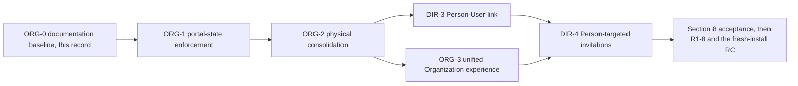

# Release 1.0: ORG-0 Organization consolidation (architecture reconciliation and work-package specifications)

**Status:** **documentation only; design approved by the owner (2026-11-18).** Nothing described here as ORG-2, ORG-3, DIR-3 or DIR-4 is implemented, and none of those packages is authorized to start: each needs its own explicit owner authorization. **ORG-1 has since been implemented on its feature branch and has passed the independent pre-commit security review (ACCEPT); it is not yet merged into `main`** (hosted CI pending): see [section 11](#11-org-1-as-built-implementation-record); sections 1 to 10 are otherwise unchanged and describe the design. Written against `main` at `010d4e0` (PR #72, DIR-1 merged). No application code, migration, database, seeder, factory, test, configuration or deployment asset was changed by ORG-0. Release 0.9 staging is untouched.

**What this record is.** The decision is in [ADR-011](../architecture/adr/ADR-011-organization-consolidation-and-lifecycle.md) and is not repeated here. This record holds what an implementer and a reviewer need: the owner-ruling and decision register, the verified current state, the terminology, the security and migration contracts, the lock-acquisition matrix, the package contracts with their prerequisites, acceptance criteria and review gates, the amended acceptance scenario, and the open items. It **replaces the DIR-2 specification** of the [DIR-0 record](./release-1.0-dir-0-directory-identity-organization.md) (section 6 there is superseded, not deleted).

**Sources.** The architectural reconciliation assessment of 2026-11-18 (a Claude Doc, decisions D1 to D14 and questions Q1 to Q8), the independent review of the same day (corrections C1 to C7, findings SF-1 to SF-7), and the owner rulings recorded in section 1. Where this record goes beyond a ruling it says **Recommendation**. Where a statement is about the code it says **as built**; everything else is **target**.

**One-sentence goal.** Before Release 1.0, an operator manages one Organization (one id, one name, one profile, one lifecycle) in the Directory, enables and disables its portal access as an explicit, audited state that is enforced at every security decision, and no Directory-only Organization can acquire portal capability merely because its row exists.

## 1. Owner rulings and decision register

### 1.1 Final owner rulings (2026-11-18)

| # | Ruling | ADR-011 | Package |
|---|---|---|---|
| A | **Disabled Organization.** Refuses new live invitations, acceptance, new memberships, privilege elevation and administrator approval, new support grants, new partner designations and managed relationships, new Service Requests, and suspended partner-support activity. Allows (subject to existing authorization) membership removal and demotion, approval revocation, support-grant revocation, invitation revocation, removal of managing relationships, and ordinary profile and non-privileged settings maintenance. Preserves historical, already-authorized Service Request visibility and replies. No automatic deletion, account closure or session termination. No organization-wide historical Ticket visibility | §3 | ORG-1 |
| A2 | **Pending invitations: permanently revoke** every outstanding live invitation when an Organization is disabled, transactionally, with a stable reason (`organization_disabled`), provenance, no queued send, no reactivation on re-enable, and an independent revalidation at acceptance. Actor-first lock order | §4 | ORG-1 |
| B | **Organization Classification** in Release 1.0: built-in `general` (default), `client`, `vendor`; exactly one; non-nullable string column default `general` (subject to implementation verification); selector in ORG-3; no authorization effect; no `partner` classification; additive, idempotent, never auto-assigning future provisioning | §6 | ORG-2 (storage, service), ORG-3 (selector) |
| C | **Navigation.** Directory → Organizations is canonical (one list, one detail). System → Organization access remains, as a filtered list of ever-enabled Organizations (Enabled and Disabled) that links into the canonical detail. Never a second editor | §10 | ORG-3 |
| S | **Staged Organization administration** is recorded as a deferred roadmap entry, not an implementation plan | Deferred | roadmap |

### 1.2 Approved architecture (decisions of the assessment, as approved)

| ID | Decision | Status | Where recorded |
|---|---|---|---|
| D1 | One canonical `organizations` table; `crm_companies` retired by forward migration in ORG-2. Replaces ADR-010 decision 2 and DIR-0 ruling R13 | Approved | ADR-011 §1 |
| D2 | Three portal states, no return to Not enabled; `portal_enabled_at` and `portal_enabled_by` both set or both NULL | Approved | §2 |
| D3 | Forward migrations only; no existing migration file edited; the ORG-2 migration refuses a populated `crm_companies` before the first destructive DDL | Approved | §12 |
| D4 | Refactor forward from `010d4e0`; no revert or reset of DIR-0 or DIR-1 | Approved | §1, §12 |
| D5 | Disabled-state behaviour. **Replaced by ruling A and A2** | Approved (as A, A2) | §3, §4 |
| D6 | Initial enablement needs `manageMembership`; disabling and re-enabling an existing portal Organization retain `manageRelationships` (R1-4): separate operations, separate abilities. Each is checked in the controller **and** the service, with a table-based check under the lock and an audit entry | Approved | §2 |
| D7 | People are visible to operators only; the through-company tenant scope is retired | Approved by assessment and review; **to be confirmed** by the ORG-0 review (the 2026-11-18 instruction did not restate it) | §7 |
| D8 | One optional affiliation column per Person in Release 1.0, re-pointed to `organizations.id`; the affiliation table is later | Approved | §7 |
| D9 | Organization phone, website and address stay native columns | Approved | §8 |
| D10 | Attributes: a recorded contract only; the column is never named `attributes`; provisionally `custom_attributes` | Approved (Future) | §8 |
| D11 | Classification. **Replaced by ruling B** (a minimal implementation, not only a contract) | Approved (as B) | §6 |
| D12 | Organization roles: no code in Release 1.0; four layers kept apart; Spatie `teams` stays off; global roles are never templates | Approved (Future) | §9 |
| D13 | ORG-0 to ORG-3 replace DIR-2; DIR-3 and DIR-4 are kept with amended dependencies and DIR-4's lock table amended | Approved | §14 |
| D14 | Only a never-enabled Organization can be deleted; `organization_members.organization_id` becomes RESTRICT | Approved | §11 |

### 1.3 Questions of the assessment, as answered

| # | Question | Answer |
|---|---|---|
| Q1 | Catalogue and default | **Ruled (B):** `general` (default), `client`, `vendor`; no `partner`. Supersedes the review's suggested `unclassified`, `prospect` and `supplier` |
| Q2 | Routes and System → Organization access | **Ruled (C).** Route names are chosen in the ORG-3 design within the constraints of section 7 (ORG-3) |
| Q3 | Operator raise-on-behalf; does enabling keep attaching the operator as an `admin` member? | **Open** (DIR-0 section 11). The attachment stays unchanged in ORG-1 and ORG-2: it is what lets the operator file a request. Not a blocker of ORG-1 |
| Q4 | Rename `owner_id` | **Approved:** replaced by `portal_enabled_by` (nullable) |
| Q5 | Historical-migration tests that need `crm_companies` | **Open, ORG-2 design:** roll the new migration back first where that is one line; retire the rest with a note (recommendation) |
| Q6 | Development databases holding hand-made companies | **Open, per environment.** The owner authorizes clearing or rebuilding each one before ORG-2 runs on it. None is assumed. Gates *running* ORG-2, not ORG-0 or ORG-1 |
| Q7 | A Directory-only Organization recorded as managed by a partner | **No** in Release 1.0: the managing relationship feeds partner support, and the fence refuses it |
| Q8 | Remove the unused `org.*` and `*.view_org` permissions | **Not activated** in Release 1.0. Removal is separate, later work (it needs a `roles:sync` step and changes the built-in role) |

## 2. Verified current state

Read from code, migrations, tests and records at `010d4e0` by the assessment and its review, and spot-checked for this record. Paths are under `src/`. **This section describes the as-built system; it does not change when ORG-1 to ORG-3 are approved, only when they merge.**

**Schema.**

| Table | Columns beyond `id` and timestamps (as built) |
|---|---|
| `crm_companies` | `name`, `website`, `phone`, `address`, `notes`, `organization_id` (nullable, unique, SET NULL), `created_by` (RESTRICT) |
| `organizations` | `name`, `slug` (unique), `owner_id` (NOT NULL, RESTRICT), `managed_by_organization_id`, `can_manage_customers`, `disabled_at` |
| `crm_contacts` | `crm_company_id` (nullable, SET NULL), names, `email` (indexed, not unique), `phone`, `job_title`, `notes`, `created_by` |
| `project_company` | `project_id`, `crm_company_id` (RESTRICT), composite primary key |

Foreign keys (`database/profile/foreign-keys.json`): `crm_contacts.crm_company_id` and `project_company.crm_company_id` point at `crm_companies`; `tickets.organization_id` (RESTRICT), `organization_invitations.organization_id` (RESTRICT), `organization_members.organization_id` (**CASCADE**) and `organizations.managed_by_organization_id` (RESTRICT) point at `organizations`; `crm_companies.organization_id` (SET NULL) links the pair.

**The pair.** `CrmService::promoteToOrganization` is the only application code that inserts an `organizations` row (copies the name once, sets `owner_id`, attaches the acting operator as `admin`). No name synchronization exists. A promoted company with no relationship and no project link can be deleted, leaving a portal Organization with no profile. No application path deletes an `organizations` row. "Enable portal access" is gated by `can:crm.manage` on the route alone, with no service authorization and no activity-log entry. The "exactly one company" rule gates every partner and managed-customer relationship.

**Disabled state.** `disabled_at` blocks filing a new request (`ServiceRequestAccess`), partner support (`PartnerSupportAccess`), a new support grant (`PartnerSupportGrants`) and is counted by the dashboard. It is **not** read by membership add, promote, demote or approve (`OrganizationMembership`), by invitation issue, resend or acceptance (`OrganizationInvitations`, zero occurrences), by partner designation or customer link (`OrganizationRelationships`), or by any tenant scope. A Disabled Organization can therefore still be invited into and joined; no existing test covers it.

**Tenancy.** Three global scopes, all bypassed for a holder of `portal.operator`; none reads organization state. No customer capability comes from an `organizations` row alone: it comes from a membership row, plus a grant, a relationship and a not-disabled check for partner support. A Person's company decides exactly one thing, the contact's tenant scope (`OrganizationThroughCompanyScope`). Customer-facing code reads Organizations through explicit column lists (`id`, `name`).

**Invitations and locking.** The global lock order is users.manage permission row → user rows → organization rows ascending → invitation rows ascending → the rest (R1-3, section 9). Issue, revoke and accept lock the Organization row exclusively and check only that it exists. The authority-loss hooks take no Organization lock and write revocation columns without the uniqueness slot. Inside those transactions authority is read from tables, never through the Gate.

**Release safeguards.** 58 migrations; 45 SHA-256 pinned as the rehearsal baseline (including the four that create `organizations`, `crm_companies`, `crm_contacts` and `project_company`) and 7 pinned candidates. "Shipped migrations are not edited." Release 1.0 is a fresh install and a migration may refuse a populated table (R1-0). `database:verify` compares live foreign keys with the manifest in both directions and does **not** pin columns, indexes or CHECK constraints. The rehearsal `IntegritySnapshot` and `organizations:preflight` both query `crm_companies` directly; `RestoreDrill` runs the snapshot on the current schema. `BaselineFixtures` populate `crm_companies`, `crm_contacts` and `project_company`. Hosted CI migrates fresh and runs a host-parity smoke on a MyISAM, latin1 MariaDB 11.4.

**Roles.** Spatie `teams` is off with stock models and one guard. The permission catalogue is a flat list with no scope or delegability metadata. Custom global roles can carry any permission, including `portal.operator`. `organization_members.role` and administrator approval authorize nothing today. `org.admin`, `org.invite`, `org.manage_roles` and the `*.view_org` permissions are checked by no code. Any `users.manage` holder can assign any role including `operator` (contained by the customer route allowlist).

**DIR-0 and DIR-1.** DIR-0 changed only documents. DIR-1 is presentation and read queries (no migration, route, permission or configuration change). The planned DIR-2 name synchronization, delete guard and profile repair are not implemented.

## 3. Terminology (contract for the implementing packages)

`AGENTS.md` is **not** changed by ORG-0: its terminology rules describe the as-built pair and stay correct until ORG-2 retires `crm_companies`. The rules below take effect with the package that changes the behaviour. **ORG-2 updates the `AGENTS.md` technical naming and contracts** (the paragraph that defines Organization as spanning two records, and its list of technical names) when `crm_companies` and its technical references are retired. **ORG-3 updates any remaining user-facing terminology** as its interface changes require.

| User-facing term | Means | Technical name |
|---|---|---|
| **Organization** | the one canonical entity (profile and portal access together) | `Organization`, `organizations` (and `CrmCompany`, `crm_companies` until ORG-2) |
| **Portal access** | the state and section: **Not enabled**, **Enabled**, **Disabled** | `portal_enabled_at`, `disabled_at` |
| **Enable portal access** | initial enablement (Not enabled → Enabled) | enable service step |
| **Re-enable** / **Disable** | Disabled → Enabled; Enabled → Disabled | `OrganizationRelationships::enable/disable` |
| **Organization access** | the System list of ever-enabled Organizations | `organizations.index` |
| **Classification** | the one built-in classification of an Organization: General, Client, Vendor | `organizations.classification` (proposed) |
| **Partner**, **Managed by**, **Managed customers** | the administrative managing relationship; unchanged wording and **not** a classification | `can_manage_customers`, `managed_by_organization_id` |
| **Person**, **People** | a Directory record of a human | `CrmContact`, `crm_contacts` |
| **Directory profile** | retired as a separate term once `crm_companies` is gone | |

Operator-visible text keeps the DIR-1 rules (never "Company", "CRM", "Org", "Promote", or "Contact" for a Directory record). "Contact" keeps its Helpdesk meaning. "Customer" is avoided as a classification name: it already means a non-operator account (the Users filter) and appears in "Managed customers".

## 4. Package sequence and shared invariants

ORG-3 and DIR-3 are independent of each other and can proceed in parallel once ORG-2 is merged. DIR-4 needs both. Each package is one pull request. Package sizes (relative): ORG-1 M, ORG-2 L, ORG-3 M, DIR-3 M, DIR-4 L.

**Invariants every package keeps** (tests in every package prove the ones it could affect). These are the DIR-0 invariants S1 to S10 with the restatements that consolidation requires (the originals stay in the DIR-0 record as history):

| # | Invariant | Restatement |
|---|---|---|
| S1 | No new permission, so no `roles:sync` step; no built-in role change | Unchanged. Classification is not a permission |
| S2 | No new route on the customer-pilot allowlist; a customer receives 404 for every Directory and System route in `closed` and `pilot` modes. Feature tests run in `pilot` mode | Unchanged. Applies to every renamed or merged route |
| S3 | No Person, Organization profile field or note appears in any customer or partner response, shared prop, mail or export | **Widened:** Organization profile fields and internal notes, not only Person data, and partner pages |
| S4 | A Person–User link is read by no policy, scope, gate or query that decides access | Unchanged. **Added:** a Person affiliation is read by none either |
| S5 | `organization_members` is written only by `OrganizationMembership`, `PartnerSupportGrants` and the enablement step | The "existing promotion step" becomes the enablement step of the Organization directory service. An invitation still creates only an ordinary, unapproved `member` |
| S6 | `TicketPolicy`, `ServiceRequestAccess`, `PartnerSupportAccess`, the three tenant scopes and `CustomerPilotGate` are not changed | **Restated:** `TicketPolicy`, `ProjectPolicy`, `CustomerPilotGate` and `OrganizationMembershipScope` are unchanged. `ServiceRequestAccess` and `PartnerSupportAccess` gain the portal-state predicate as a second line beside `disabled_at` (the drift test stays meaningful). `OrganizationScope` loses its only consumer; `OrganizationThroughCompanyScope` is replaced by an operator-only scope (ORG-2) |
| S7 | Managing-relationship facts are built only for an actor who passes `manageRelationships` | Unchanged |
| S8 | Every state-changing act is authorized in the controller and again in the service, requires an active account, runs in one transaction and writes its activity-log entry in it | Unchanged. **Includes** enablement, disable, re-enable, profile edit, classification change and delete, none of which satisfied it as built |
| S9 | The lock order is extended, never reordered | Restated in section 6 |
| S10 | Release safeguards are unchanged: fresh-install migration, `database:verify` with the foreign-key manifest, `runtime:preflight`, hosted CI and browser suites, no Release 0.9 staging change | The safeguards stay; **their inputs change** (manifest, preflight, snapshot, historical tests: section 5.4) |
| S11 (new) | A Directory-only Organization has no member, invitation, ticket, partner designation or managing relationship, and gains none through any route | Service-enforced under the row lock; `organizations:preflight` fails on a violation |
| S12 (new) | Classification is never read by an authorization decision | Source-scanning test |

## 5. Security and migration contracts

### 5.1 Findings carried from the two assessments

| ID | Severity | Finding | Required resolution | Package |
|---|---|---|---|---|
| SF-1 | Medium (existing) | A Disabled Organization can be invited into and joined, including by invitations issued before it was disabled | State read on the row already locked at issue and at every acceptance read; plain reads in `findOpen` and `shouldSend`; permanent revocation on disable (ruling A2) | ORG-1 |
| SF-2 | Medium (existing) | Add, promote, approve, designate and assign read no `disabled_at` | Same state read under the existing locks; the allowed acts stay allowed | ORG-1 |
| SF-3 | High if missed | The Directory-only fence: required at every site of ADR-011 §5. Today a Directory-only row (`disabled_at` NULL) would pass every existing check | The predicate at every site, read from the table | ORG-1 |
| SF-4 | Medium | Lifecycle integrity: CHECK pairing (C5); initial enablement refuses a Disabled row and never clears `disabled_at` (C6); disable and re-enable refuse a Not enabled row with a clear message before a CHECK fires | Service refusals plus CHECKs | ORG-1 |
| SF-5 | Low | `promoteToOrganization` has no service authorization and no audit entry (over HTTP the pilot gate effectively requires `portal.operator` with `crm.manage` in `pilot` and `closed` modes; legacy mode has no such gate: C1) | `manageMembership` in controller and service for initial enablement (disable and re-enable keep `manageRelationships`, which they already check); table-based check under the lock; audit entry with the same timestamp as `portal_enabled_at` | ORG-1 |
| SF-6 | Medium | Profile fields (including `notes`) sit on a row members can load; `Ticket::organization` loads the whole row; only presenter allowlists keep them out of responses | Recursive leakage test over customer pages, partner pages, shared props and mail; optional `$hidden = ['notes']` | ORG-2 |
| SF-7 | Medium | Readers that assume "a row exists, so portal access exists": `OrganizationListFacts::portalStatus`, the dashboard organization count, both candidate lists, `organizationsWithoutApprovedAdministrator` in the preflight (C7) | Filter to `portal_enabled_at IS NOT NULL` | ORG-1 (count, preflight), ORG-2/3 (status, lists) |
| C4 | High (ORG-2) | Deleting a Directory-only row locks the Organization and, through SET NULL, the affiliated Person rows; a Person affiliation write locks the Person then share-locks the Organization through its foreign key: a real cycle | Organization row first; two-connection delete × Person affiliation test | ORG-2 |

**Bypass sweep (review):** no other writer of Organization state exists. Every organization-changing route goes through the services above. The only queued job that grants anything is the invitation mail. Ticket notifications already re-check `disabled_at`. `CleanupE2eInvitees` only deletes; the seeder, the baseline fixtures and the factories are not production paths.

**Condition the factories must meet:** the factories and `DevSeeder` default to Enabled, so the existing invitation, membership and partner suites remain the unchanged control group.

### 5.2 Disabled-state behaviour by act (ORG-1 test matrix)

Every row is tested through the route **and** through the service, with no row written on a refusal, in all three portal states.

| Act | Not enabled | Enabled | Disabled |
|---|---|---|---|
| Issue, resend or reissue an invitation | refused | allowed | **refused** |
| Accept an invitation (password and SSO) | refused | allowed | **refused** |
| Revoke an invitation | n/a | allowed | allowed |
| Add a member | refused | allowed | **refused** |
| Promote to administrator; approve an administrator | refused | allowed | **refused** |
| Demote, remove, revoke approval | n/a | allowed | allowed |
| Grant support access | refused | allowed | **refused** |
| Revoke support access | n/a | allowed | allowed |
| Designate a partner; link or reassign a managed customer (both ends) | refused | allowed | **refused** |
| Remove a designation; unlink a customer | n/a | allowed | allowed |
| File a new Service Request | refused | allowed | refused (as built) |
| Partner-support read, reply, create (partner or customer) | refused | allowed | refused (as built) |
| Requester reads or replies on their own existing request | n/a | allowed | **allowed** (kept deliberately, and tested) |
| Edit profile, change Classification | allowed | allowed | allowed |
| Initial enablement | allowed | refused | **refused**, never clears `disabled_at` |
| Disable | refused | allowed (revokes live invitations) | refused (no-op) |
| Re-enable | refused | refused (no-op) | allowed (never reactivates invitations) |

"n/a" means there is nothing to act on in that state (a Directory-only Organization has no invitation, member or grant); the invariant S11 forbids creating one.

### 5.3 Effective access while Disabled

| Access path | Effective today while Disabled | Release 1.0 |
|---|---|---|
| Requester views or replies on their own requests (`TicketPolicy`, not dependent on the Organization) | Yes | Keep (R1-4 section 5) |
| File a new request | Refused | Keep |
| Partner support (partner or customer disabled) | Refused | Keep |
| Pending invitation becomes an account and a membership | **Allowed** | **Refuse (SF-1)**; outstanding invitations revoked on disable |
| Operator add, promote or approve | **Allowed** | **Refuse (SF-2)** |
| Designate or link | **Allowed** | **Refuse (SF-2)** |
| Approved-administrator and support-grant records | Grant nothing while disabled | Keep the records. Any future Organization-scoped authority requires record AND Organization Enabled and not Disabled AND user active |

### 5.4 Migration, rehearsal and release-safeguard implications

| Item | Implication |
|---|---|
| Existing pinned migrations | 45 baseline and 7 candidate SHA-256 pins stay valid: no migration file is edited, not even a comment. New behaviour arrives only in new migration files |
| ORG-2 and the rehearsal candidate set | **ORG-2 must not be added to `database/rehearsal/candidates.php`**: `BaselineFixtures` intentionally populate `crm_companies`, `crm_contacts` and `project_company`, so the migration would refuse. A migration need not be a candidate to ship (R1-0). This does not waive the migration-specific tests or restore-drill compatibility |
| Refuse before the first destructive DDL | ORG-2 refuses a populated `crm_companies` (counts only) before dropping or altering anything; MariaDB commits DDL implicitly, so each piece is resumable and detects completed work. A populated `crm_companies` implies empty affiliations and project links through their foreign keys, so no id remapping is needed |
| `down()` | Schema-only. ORG-2's `down()` cannot restore profile data, Directory-only Organizations, affiliations or project links and **refuses when any exist**; it never claims to restore deleted data. ORG-1's `down()` refuses while any `portal_enabled_by` is NULL, so ORG-2 is rolled back first |
| Foreign-key manifest | `database/profile/foreign-keys.json` is regenerated in the same change: the keys that name the company table are replaced, the project-link keys renamed, `organization_members.organization_id` becomes RESTRICT (ORG-1), `portal_enabled_by` added |
| `database:verify` | Does not pin CHECK constraints or columns. The pairing CHECK and the state CHECKs are re-verified by `organizations:preflight` and the integrity snapshot |
| Historical-migration tests | `TicketAttributionMigrationTest`, `PreservationMigrationsTest` (M2, M3), `PreservationSchemaTest` and the unique-link part of `ManagedOrganizationMigrationTest` break once `crm_companies` is gone. Each is retired with a note or made to roll the new migration back first (Q5, ORG-2 design) |
| Rehearsal integrity snapshot | `IntegritySnapshot` reads `crm_companies`; it must be **schema-conditional** so it still runs on the pinned baseline. `RestoreDrill` runs it against the current schema, so without this the backup drill fails after ORG-2 |
| Backup integrity snapshot, backup and restore tooling | Tables are discovered from the dump; unchanged. The restore-drill compatibility above is the only coupling |
| `organizations:preflight` | Rewritten in ORG-2: the company section is replaced by the Directory-only invariant checks and the pairing check; the administrator-approval and dashboard filters land in ORG-1 |
| Host-parity checks | The smoke on MyISAM/latin1 MariaDB 11.4 exercises the new DDL (CHECK constraints, renamed columns, foreign keys). MariaDB acceptance of the CHECKs is an assumption to verify (A2, below) |
| Fresh install | `migrate --force`, `database:verify` and `organizations:preflight` pass on a fresh install after each package |
| Release 0.9 staging | Untouched. It runs from its own release directory |

## 6. Lock acquisition matrix

**Order:** `users.manage` permission row → **user rows** → **organization rows, ascending id** → **invitation rows, ascending id** → **Person row** → the rest. S is a shared lock and X an exclusive lock; "FK-S" is the shared lock InnoDB takes on a parent row when a child row is inserted or its foreign-key column changes. A transaction that holds a shared Organization lock never upgrades it.

**Basis column.** **V** = verified existing behaviour (read from the code and records: R1-3 section 9 and 6.2.3, R1-4 section 5, the MO-1A and MO-2A1 records, the assessments). **P** = proposed change, reasoned from documented InnoDB behaviour and **not yet proved**. Every P row needs real-connection validation in the package that introduces it.

| Transaction | Lock sequence | Portal state required | Basis |
|---|---|---|---|
| Invitation issue, resend | actor user S → org X → slot-holder invitation X → insert | Enabled, not Disabled | V (sequence); P (state read) |
| Invitation revoke (operator) | actor S → org X → invitation X | any | V |
| Invitation acceptance (password or SSO) | issuer S → org X → invitation X → user insert, membership (re-reads org X) | Enabled, not Disabled, read at every acceptance read | V (sequence); P (state read) |
| Authority-loss hooks (issuer suspension, role or permission change, `reconcileIssuers`) | actor and invitation rows before the mutation, **no org lock**; write revocation columns without the slot; the permission-cache epoch is advanced first (R4) | n/a | V |
| Member add, promote, approve | org X → membership X → FK-S on users | Enabled, not Disabled | V (sequence); P (state read) |
| Demote, remove, revoke approval | org X → membership X | any | V |
| Support grant | users S (actor, member) ascending → org X → membership X | Enabled, not Disabled | V (sequence); P (portal-state read; Disabled already refused) |
| **Partner-support create or reply** (`PartnerSupportAccess::refusal`, inside the creation or reply transaction) | users S (the actor and the nominated contact; only an existing id is locked) ascending → org rows S (customer and partner, one statement) ascending → partner membership S (then the contact's customer membership S) | Enabled, not Disabled, both rows; the existing authority conditions stay (actor active and not an operator, partner designation, relationship, complete support grant, eligible contact) and tenant isolation is unchanged | V (sequence); P (portal-state read on both organization rows, ORG-1, beside the existing `disabled_at` reads; the `PartnerSupportAccess` drift test (its unlocked and locked reads) stays meaningful; both reads gain the predicate) |
| Partner designation, customer assignment or link | org rows X ascending | Enabled, not Disabled, both rows | V (sequence); P (state read; replaces the one-company check) |
| Remove designation, unlink | org rows X ascending | any | V |
| **Disable, with transactional invitation revocation** | **actor user S first** → org X → *then* nominate the open invitations → lock them X in ascending key order → revalidate under lock → revoke (contract: [6.2](#62-disable-time-invitation-revocation-transaction-contract)) | Enabled | **P**; today's disable locks the org row `FOR UPDATE` only (V) |
| Re-enable | org X | Disabled | V (lock); P (state refusal) |
| **Portal enablement** (initial; target, ORG-2) | actor S → org X → state write (FK-S on actor through `portal_enabled_by`) → the operator's admin membership | Not enabled | **P**; today's promotion locks the Directory profile row and inserts the Organization (V), with no actor lock |
| Profile or Classification edit (ORG-2) | org X as the only lock, short transaction | any | **P** |
| **Organization delete** (ORG-2) | org X, re-read under the lock → SET NULL on affiliated Person rows → RESTRICT checks (project links, dependants) | Not enabled only | **P**; today's company delete is a two-attempt, two-table choreography (V) that disappears |
| **Person write that sets an affiliation** (ORG-2) | **org S first** → Person X | not fenced (an affiliation decides no access) | **P**; today it takes FK-S on the profile row, outside the invitation order (V) |
| **Project–Organization association write** (ORG-2) | org rows S ascending → link insert | not fenced | **P**, *recommended, not required*, and it needs implementation verification on real connections; the alternative is to make the link write the only statement of its transaction (today the FK points at the profile row) |
| Ticket creation | org S → membership S (R1-2) | Enabled, not Disabled | V (sequence); P (state read, beside the existing `disabled_at` read) |
| **DIR-4 Person-targeted issue** | actor S → org X → slot holder X → Person X (validate) → insert | Enabled, not Disabled | P (DIR-0 section 8, with the state read) |
| **DIR-4 Person-targeted acceptance** | issuer S → org X → invitation X → Person X (four conditions) → account, membership, link | Enabled, not Disabled | P (DIR-0 section 8, with the state read) |
| **DIR-4 Person email change that revokes** | actor S → the Person's open targeted invitations (nominated by a plain read, locked by key, ascending, no org lock) → Person X → re-read → revoke and update | n/a | P (DIR-0 section 8; stands for a revocation-only change) |
| **DIR-4 Person email change together with an affiliation change** | actor S → **org S** → invitations X → Person X | not fenced | **P**; the DIR-0 sequence takes no org lock and is amended: split the affiliation change into its own transaction, or take the org lock first |
| DIR-4 Person delete | the Person's invitation rows (ascending) → Person X → re-read → clear references, delete | n/a | P (DIR-0 section 8) |
| DIR-3 link, unlink, create from a User | user rows S ascending → Person X | n/a | P (DIR-0 section 7); unchanged by consolidation |

**Why "actor first" on disable.** Disabling writes `revoked_by`, a foreign key to the actor. A suspension of that same actor holds their user row exclusively while it waits for the invitation rows. If disable took the actor row late, through the foreign key, the two would deadlock. Taking it first follows the actor-first pattern of R1-3 (rule R3). The other R1-3 rules are not carried over wholesale: see section 6.2.

**The new parent-lock hazard.** After ORG-2, People and project links reference the Organization row. A Person write holds the Person row and waits for FK-S on the Organization; a Person-targeted acceptance holds the Organization exclusively and waits for the Person row. Neither can proceed. The rule: **organization row first, shared, before any invitation or Person row.** The repository already documents the equivalent behaviour for `project_company` (`CrmService`).

**Stated limit (carried from R1-3 6.2.3).** The argument is at the row level. Index-gap locks can create residual cycles that end in one atomic abort; deadlock freedom beyond the row level is not claimed.

### 6.1 Two-connection MariaDB concurrency tests (required; each pair in both orders)

All run on real MariaDB 11.4 connections, not mocks, as R1-3 did.

| Package | Pairs |
|---|---|
| **ORG-1** | Disable against accept, issue, add, promote, approve, grant, and designate/assign. Disable against the issuer's suspension, against a role or permission change (`reconcileIssuers`), and against an operator revoking the same invitation. A **query-log pin** that an ordinary acceptance takes the same locks in the same order as before. (Enable × issue and enable × add are **not** here: in ORG-1 promotion creates the row already Enabled, so no Not enabled → Enabled step exists until ORG-2: C2) |
| **ORG-2** | Initial enablement against issue, against add, against delete. Delete against Person affiliation (C4) and against project link. Disable and re-enable against profile or Classification edit |
| **DIR-4** | Person affiliation against a Person-targeted acceptance (C3: an ordinary acceptance never locks a Person row, so this pair exists only in DIR-4). Disable against Person email change and against Person delete (both touch open targeted invitations). Every pair already listed in DIR-0 section 8 |

### 6.2 Disable-time invitation revocation: transaction contract

Ruling A2 requires disabling an Organization to permanently revoke its outstanding live invitations in the same transaction. The contract below is **proposed** (P) and is reasoned, not yet proved on real connections; it is the shape ORG-1 must prove. It is a specific contract, not a blanket application of the R1-3 rules.

1. **Lock the acting operator's user row first** (shared). `revoked_by` is a foreign key to the actor, so InnoDB would otherwise take the actor row late, and a suspension of that actor (user X, then waiting on invitation rows) would deadlock with it.
2. **Lock the Organization row** (exclusive) **before selecting any pending invitation**, and read the portal state from that locked row (Enabled, not already Disabled).
3. **Nominate the open invitations, then lock them in deterministic ascending-key order.** Nomination is a plain read; the rows are then locked by primary key, ascending, as the other invitation writers do.
4. **Revalidate each invitation's state under the lock, at one consistent instant** (not against a snapshot taken before the locks): an invitation that an operator revoked, an acceptance that committed, or a hook that revoked it in the meantime is found as such and left alone; no new invitation can be issued between the nomination and the invitation-row locks, because the disabling transaction already holds the Organization row lock that invitation issuance also requires; the revalidation under lock stays required for the rows nominated, and any open row found at that point is locked and revoked, never skipped.
5. **Permanently revoke** each still-open invitation with the reason `organization_disabled`, `revoked_at` and `revoked_by` (the actor), preserving the historical row, and write the audit provenance (actor, time, Organization, invitation ids) in the same transaction.
6. **Never reactivate.** A previously revoked invitation (by any reason) is terminal and is never reopened by disable, by re-enable, or by any later issue; re-enabling revives nothing.
7. **No Gate, no permission-cache loading** inside this locked transaction. Authority is established before it begins (the controller) and re-checked inside it **from the tables** (the table-based predicate), never through a Gate or policy call, because a first permission-cache load inside such a transaction can close a lock cycle (R1-3, 6.2.3).
8. **Slot handling is a design decision requiring consistency with the existing invitation invariants** (R1-3 invariant I5, the `live_email` uniqueness slot): either the revocation leaves the slot as the authority-loss hooks do (the next issue for that Organization and address releases a non-open holder), or it clears the slot under the Organization lock as the operator revoke does. ORG-1's design chooses one, and a test proves that issuing a new invitation for the same address after re-enable succeeds in both the "slot left" and "slot cleared" histories, and that the unique backstop is never hit.

**What carries over from R1-3 and what does not.** Rule R3 (the actor row first) carries over, because the same foreign-key reason applies. Rule R1 (the hooks never write the slot, so they take no Organization lock) was designed for the authority-loss hooks, which run without the Organization lock; disable **holds** the Organization lock and may choose either slot behaviour (item 8). Rule R4 (advance the permission-cache epoch before a hook locks) applies to mutations of global permissions and roles; **disable mutates neither**, so no cache-epoch step is added. The disable against the issuer's suspension, against `reconcileIssuers` and against an operator revoke are the two-connection pairs of section 6.1.

## 7. Work packages: prerequisites, acceptance and gates

Each package is one pull request, authorized individually before its first line of code. Implementation detail beyond the reviewed security and integrity requirements is deliberately left to the package's own design.

### ORG-1: portal-state enforcement

**Purpose.** Make portal state a first-class, enforced fact before any Directory-only Organization can exist through normal operation, and close the existing defects SF-1, SF-2 and SF-5.

**Prerequisites.** ORG-0 merged. The **independent design review of this record** (the fence sites, the Disabled rule, the invitation revocation and the lock matrix) is accepted: it gates ORG-1 code. The owner's rulings A, A2 and B are recorded (they are). Owner authorization of ORG-1.

**Scope.**

1. One migration, forward and re-runnable: `portal_enabled_at` added and `owner_id` replaced by nullable `portal_enabled_by` (foreign key to `users`, RESTRICT), backfilled for every existing row (`created_at`, `owner_id`); the pairing CHECK and the state CHECKs of ADR-011 §2; `organization_members.organization_id` CASCADE → RESTRICT; the foreign-key manifest updated. Its `down()` refuses while any `portal_enabled_by` is NULL.
2. The portal-state predicate (one small value type) read at every site listed in ADR-011 §5, from the locked row, never through the Gate, plus the source-scanning test over readers of `organizations`.
3. Ruling A applied: the matrix of section 5.2.
4. Ruling A2: disable revokes every outstanding live invitation in its transaction (reason `organization_disabled`, audit provenance, history kept), the notification's send-time check drops a revoked row and a Disabled Organization, acceptance revalidates state under the row lock, re-enable revives nothing, and the lock order is actor-first. The transaction follows the contract of section 6.2; whether the revocation clears the uniqueness slot is a design decision that must stay consistent with the existing invitation invariants (section 6.2).
5. Initial enablement (still the existing promotion path in ORG-1) gains `manageMembership` in the controller and the service, a table-based check under the lock and an audit entry with the same timestamp as `portal_enabled_at`. Disable and re-enable are distinct from it and **retain `manageRelationships`** (R1-4); the two abilities are separate policy abilities that must not be collapsed even though they reduce to the same capabilities today. The state refusals of section 5.2 apply.
6. `organizations:preflight` fails on a Directory-only row that has any member, invitation, ticket or relationship, and its administrator-approval check and the dashboard count filter to portal-enabled rows.
7. Factories and `DevSeeder` default to Enabled; a Directory-only factory state exists for the fence tests only.

**Acceptance.**

- Each fenced act is refused through the route and through the service with **no row written** (no user, membership, social-account or invitation row). Queued mail is dropped, not failed.
- Section 5.2 verified for every act in all three states.
- The existing invitation, membership, partner-support and ticket-attribution suites **pass with no assertion changed**.
- Requester access to existing requests while Disabled is asserted, not assumed.
- The migration tests: backfill shape, CHECK enforcement, refusal and `down()`.
- The two-connection pairs of section 6.1, each in both orders; the query-log pin.
- Concurrency-test teardowns adjusted for RESTRICT (they delete organizations directly; `OrganizationMembershipConcurrencyTest` already deletes memberships first; check the rest).
- `database:verify`, `runtime:preflight` and `organizations:preflight` pass on a fresh install.

**Review gates.** Independent design review before code (above). **Independent security review before commit.** Hosted CI (full Pest and the browser suites) green before merge. **Rollback:** revert the pull request; the migration's `down()` refuses while any provenance is NULL.

### ORG-2: physical consolidation

**Purpose.** One Organization table: the profile moves to `organizations`, `crm_companies` is retired, People and project links are re-pointed, and Directory-only Organizations become possible, behind the ORG-1 fence.

**Prerequisites.** ORG-1 merged. Owner authorization. For any database that holds hand-made companies, the owner's explicit per-environment authorization to clear or rebuild it (Q6) before the migration runs on it. The `crm_companies` refusal is expected there.

**Scope.**

1. One forward migration, piecewise and re-runnable in the style of `2026_11_06_120000`. It **refuses a populated `crm_companies` before the first destructive DDL statement**, adds the profile columns (`website`, `phone`, `address`, `notes`, `created_by`, `classification`), re-points `crm_contacts.crm_company_id` to `organization_id` (foreign key to `organizations`, SET NULL) and the project link table to an Organization key (RESTRICT, same composite key), and drops `crm_companies`. The design states the backfill of `created_by` for existing Organizations (the recorded enabling operator is the natural source) and the generation of `slug` for Directory-only rows (NOT NULL, unique). `down()` is schema-only and refuses on data.
2. An **Organization directory service** replacing the `CrmService` company methods: create (Directory-only), update the profile, change the Classification, delete (never-enabled only, with explicit dependency handling), and initial enablement as a state transition on an existing row. Each is authorized in the controller and again in the service, runs in one transaction under the row lock of section 6 and writes its audit entry. The operator's automatic `admin` membership on enablement stays (Q3).
   **Authorization of the directory service (explicit).**

   | Act | Authority | Notes |
   |---|---|---|
   | Create a Directory Organization | an **active operator** (holds `portal.operator`) with **`crm.manage`** | |
   | Edit the profile | same | allowed in every portal state |
   | Change the Classification | same | allowed in every portal state; same authority as a profile edit |
   | Delete (never-enabled only) | same | the design may require a stricter ability for deletion, never a weaker one |
   | Initial enablement | `manageMembership` | separate ability (ADR-011 §2); disable and re-enable keep `manageRelationships` |

   **Service-layer protection.** Correctness must not rely on an HTTP route middleware or the customer-pilot gate. Each service method authorizes its actor itself, inside its transaction: the account is read as **active** (`users.disabled_at` NULL) from the table, and operator eligibility (`portal.operator`) and `crm.manage` are established by the table-based authority check, not through a cache-dependent Gate call inside a locked transaction. As built, the `crm.*` routes are guarded by `can:crm.manage` and the pilot gate only (legacy mode has no such gate), and `CrmService` performs no check. Tests exercise each service method directly with a customer, a suspended operator, and an operator lacking `crm.manage`, with no route involved, and expect a refusal and no row written.
3. `OrganizationRelationships` loses the one-company rule and keeps the portal-state requirement (candidate lists included). People become operator-only (operator-only scope replaces `OrganizationThroughCompanyScope`). Projects, tasks, the project filter and the dashboard are re-pointed to Organizations.
4. `IntegritySnapshot` made schema-conditional; `organizations:preflight` rewritten; `DevSeeder` sets the portal state of its Organizations; the historical-migration tests handled (section 5.4).
5. The existing pages keep working on their existing routes, now reading one table. The unified experience is ORG-3.
6. **Classification** storage, enum and service operation only: no selector. The value is never selected on a customer or partner path.
7. The foreign-key manifest regenerated; the migration is **not** added to the rehearsal candidates.
8. `AGENTS.md` technical naming and contracts updated (section 3).

**Acceptance.**

- Migration tests in the style of `OrganizationAdminApprovalMigrationTest`: refusal on populated data before any DDL, resume after a partial run, shape proof, `down()` refusing on data.
- A fresh install passes `migrate --force`, `database:verify` and `organizations:preflight`; the host-parity smoke passes.
- The two-connection pairs of section 6.1, each in both orders.
- **Leakage test:** no profile field or note in any customer page, partner page, shared prop or mail (SF-6).
- **Classification tests:** a source scan proves no policy, scope, gate, middleware or authority service reads it; a parameterized test over every value shows filing, partner support, customer routes, portal state, `can_manage_customers`, membership role and approval, and Spatie roles come out identical; classifying a Not enabled row does not enable it and classifying a partner does not change its designation; the value never appears in customer or partner responses; a no-op change writes no audit entry and a change writes one with old and new values.
- Deleting a Not enabled Organization works with its dependencies handled as stated; deleting an enabled-once Organization is refused by the service and by the database.
- A4 and A5 (below) exercised by tests, since ORG-2 rewrites those rules.
- The rehearsal and backup unit suites pass with no pin changed; the ORG-1 control suites pass again with fixture changes only.
- `AGENTS.md` technical naming and contracts no longer describe `crm_companies` or the two-record Organization (scope item 8).

**Review gates.** Focused independent review of the migration, the services and the lock order before commit, and the independent security review of the leakage and tenant-isolation results. Hosted CI green before merge. **Rollback:** revert the pull request. Data entered into profile columns after the change would be lost, which is acceptable only while no production record exists (R1-0).

### ORG-3: unified Organization experience

**Purpose.** One canonical Organization management experience over the one table.

**Prerequisites.** ORG-2 merged. Owner authorization. No schema change.

**Scope.**

1. **Directory → Organizations**: one list, one detail with an Overview and a Portal access section, one breadcrumb (Directory / Organizations / name) whichever list was used, one navigation identity. Profile, People, projects and Portal access appear subject to authorization.
2. **System → Organization access** remains, filtered to Organizations that have ever been portal-enabled (Enabled and Disabled), linking into the canonical detail. Never a second editor, service or security path.
3. The **Classification selector**: built-in values only, any value to any value, in all three portal states, same authority as a profile edit (proposed; confirmed in the package design).
4. **Route and navigation constraints (Recommendation, confirmed by the package design):** keep `organizations.show` as the canonical detail URL, because every security-reviewed portal-access action already redirects there; move `organizations.show` from the System item to Directory → Organizations in `NavigationBuilder`; narrow the System `organizations.*` pattern to `organizations.index`; retire `crm.companies.*` (a fresh install has no saved links). Preserve the existing tested portal-administration routes where practical.
5. Any remaining user-facing terminology in `AGENTS.md` that the interface change requires is amended as section 3 says (the technical naming and contracts were updated by ORG-2); the DIR-1 vocabulary and navigation tests are updated.

**Acceptance.**

- `NavigationBuilderTest`, `FocusedNavigationTest`, `directory-navigation.spec.ts`, `DirectoryVocabularyTest` and the two-list assertions of `OrganizationVisibilityTest` updated; the label pins kept.
- The "Enabled or Disabled, never Not enabled" assertion for the System list is kept.
- A browser journey: create an Organization, enable portal access on the same page, rename it, change its Classification, disable it, and be refused a delete.
- S2 holds for every touched route; no customer route is added; the customer sees no Classification.

**Review gate.** Standard code review; the Classification selector's authorization is checked in the controller and the service. **Rollback:** revert the pull request.

### DIR-3: Person–User link

**Contract unchanged** ([DIR-0 section 7](./release-1.0-dir-0-directory-identity-organization.md#7-dir-3-personuser-link)). **Prerequisite changed:** ORG-2 merged (DIR-0 had DIR-0 only). It does not need ORG-3 and can proceed in parallel with it. **Amended where consolidation changes identifiers or dependencies:** the preflight comparison of a linked Person's Organization against memberships becomes a direct Organization id comparison; "Person's Organization" means `organization_id`; the migration is one additive migration on `crm_contacts` (the table keeps its name). The lock order (user rows S ascending → Person row) is unchanged. **Gates:** the DIR-0 section 10 gates stand (independent design review of the DIR-3 and DIR-4 contracts and lock order before DIR-3 code, now including the amended matrix of section 6; independent security review before commit).

### DIR-4: Person-targeted invitations

**Contract unchanged** ([DIR-0 section 8](./release-1.0-dir-0-directory-identity-organization.md#8-dir-4-person-targeted-invitations)). **Prerequisites:** DIR-3 **and ORG-3** (the Organization experience is where a Person-targeted invitation is issued and observed). **Amended:**

- The issue and acceptance rules **enforce** "Enabled and not Disabled" (DIR-0 stated it for issue only, and as built nothing enforced it). A Disabled Organization refuses a Person-targeted issue and acceptance.
- **Disable revokes Person-targeted invitations too** (ruling A2, reason `organization_disabled`); they become ordinary historical rows with `person_targeted` kept, and never block Person deletion.
- **Locking:** any Person write that sets or changes an affiliation takes the Organization row (shared) before any invitation or Person row. The Person email change that also changes affiliation is `actor S → org S → invitations X → Person X`, or the affiliation change is its own transaction. The revocation-only email change stands as DIR-0 specified it (no Organization lock).
- **Test ownership:** the Person-affiliation × targeted-acceptance pair belongs here, with the disable × Person email change and disable × Person delete pairs, and the existing DIR-0 section 8 list (section 6.1).
- **Gates:** independent design review of the contract and the amended lock order before code; independent security review before commit; two-connection MariaDB proofs for every pair, in both orders.

## 8. Release acceptance and gates

The DIR-0 section 9 scenario stands with these edits (the original stays in the DIR-0 record):

- **Steps 1 and 2 happen on one page** (Directory → Organizations): create the Organization (Not enabled) and enable portal access (Enabled) without leaving it. System → Organization access lists it.
- **New step 15, Directory-only inertness:** a Directory-only Organization cannot be given an invitation, member, partner designation, managed relationship, support grant or request by any route, and a customer sees no trace of it.
- **New step 16, Disabled:** disable an Organization that has an outstanding invitation; the invitation shows Revoked (reason: the Organization was disabled) and the mailed link shows the uniform unavailable page; re-enable does not revive it; the requester still sees and replies to their existing request; a new request is refused; a new invitation is a new credential.

| Gate | When |
|---|---|
| Independent review of **this record** (the fence sites, the Disabled rule, the invitation revocation, the lock matrix, D7) | before ORG-1 code |
| Owner authorization of each package, individually | before its first line of code |
| Independent security review of ORG-1; focused review of ORG-2; independent security review of DIR-3 and DIR-4; independent design review of DIR-4's contract and the amended lock order | per package, as in section 7 |
| Two-connection MariaDB concurrency proofs, each pair in both orders | ORG-1, ORG-2, DIR-4, before each is committed |
| Hosted CI (full Pest and the browser suites) green | before each merge |
| Fresh install: `migrate --force`, `database:verify`, `organizations:preflight` with no failure | each package, and the release candidate |
| Section 8 scenario passes on the release candidate | before R1-8 acceptance closes |
| The operator raise-on-behalf readiness question (DIR-0 section 11) is ruled on | before R1-8 acceptance closes |

No package changes the customer surface, the permission catalogue or a built-in role, so the release notes' statement that there is nothing for `roles:sync` to apply stays true.

## 9. Open items and deferred documentation

**Open owner or design decisions** (none blocks ORG-0 or the start of ORG-1 design):

1. **Q3 operator raise-on-behalf** (DIR-0 section 11): unchanged and open; the enabling operator's automatic `admin` membership is kept.
2. **Q5** historical-migration tests: roll back first versus retire (ORG-2 design).
3. **Q6** development databases with hand-made companies: per-environment owner authorization before ORG-2 runs.
4. **Q8** removal of the unused `org.*` and `*.view_org` permissions: separate later work with a `roles:sync` step.
5. **D7** (People operator-only): confirm in the ORG-0 review.
6. **Classification details:** the user-facing label of `general` (proposed "General"); the Classification authority is specified in ORG-2 (same as a profile edit) and confirmed by that design; the storage contract (`VARCHAR(32) NOT NULL DEFAULT 'general'`, with or without a CHECK), subject to implementation verification.
7. **ORG-1 design details:** whether the disable's revocation clears the uniqueness slot; the exact reason text shown to operators.
8. **ORG-2 design details:** the `created_by` backfill for existing Organizations; the dependency handling of delete (refuse or remove project links); whether to take the project-link write under an Organization lock (recommended, not required); an optional retry on a duplicate slug; optional `$hidden = ['notes']` and an optional database CHECK on classification.
9. **Outside the ORG scope:** the `users.manage` role-assignment ceiling, to be closed before any delegated role administration.

**Assumptions requiring verification:**

| # | Assumption | How to verify |
|---|---|---|
| A1 | The foreign-key parent-lock interactions of section 6 behave as reasoned | Two real connections on MariaDB 11.4, each pair in both orders |
| A2 | MariaDB accepts the proposed CHECK constraints (the known refusal, error 1901, concerned an AUTO_INCREMENT column) | The migration test and the host-parity smoke |
| A3 | The rehearsal and backup unit suites pass unchanged once the integrity snapshot is schema-conditional | Hosted CI on the ORG-2 pull request |
| A4 | `CrmService::updateCompany` cannot clear an optional field once set (read from the code, not exercised) | A test in ORG-2, which rewrites the method |
| A5 | A scoped non-operator's project-link sync may detach links it cannot see (inferred, not exercised) | A test in ORG-2, which rewrites the rule |

**Documents deliberately not changed by ORG-0** (they describe as-built behaviour and change with the package that changes it):

| Document | Changes with |
|---|---|
| `docs/architecture/database-schema.md` (table shapes; the sentence that an `organization_roles` table is planned, which should then point at ADR-011 §9) | ORG-1 and ORG-2 |
| `AGENTS.md` (the terminology paragraph that defines Organization as spanning two records, and its list of technical names) | ORG-2 (technical naming and contracts); ORG-3 (any remaining user-facing terminology) |
| `docs/testing/migration-rehearsal.md` (one sentence on the schema-conditional integrity check) | ORG-2 |
| Code comments that restate the pair model (`NavigationBuilder`, `PermissionCatalogue`) | the code that carries them |
| `docs/architecture/database-profile.md`, `runtime-preflight.md`, `docs/operations/backup-and-recovery.md` | no change expected |

**Separate cleanup, not absorbed into ORG-0:** the ADR-010 Status line still says that nothing is implemented although DIR-1 has merged (the DIR-0 record carries "DIR-1 as built"); `rbac-design.md` has other stale statements beyond the two annotated by ORG-0.

**Contradictions found while reconciling, and how they were resolved** (see the handback for the review's attention):

1. The assessment placed the classification column outside the release (a small optional package after ORG-3); the final owner ruling B places it in ORG-2 with the selector in ORG-3. **Ruling B governs.**
2. The independent review suggested the catalogue Unclassified, Client, Prospect, Supplier with default `unclassified`; the final ruling is `general`, `client`, `vendor` with default `general`. **The ruling governs.**
3. The assessment's ORG-1 tests included enable × issue and enable × add, and its ORG-2 tests included Person affiliation × acceptance. Both were corrected by the review (C2, C3) and are placed in ORG-2 and DIR-4. **The corrected placement is used.**
4. The assessment (and ADR-010 as built) said Enable portal access needs `crm.manage` only; the review corrected it (C1) for `pilot` and `closed` customer modes. **Both statements are recorded in SF-5.**
5. The local `main` ref in the working copy was stale (`88f884d`) while GitHub `main` is `010d4e0`. The branch was created from `010d4e0` after fetching `origin/main` (the tree matches the checkout used by the assessment).

## 10. Documentation inventory and decision traceability

ORG-0 creates or amends the documents below. The original text of every amended record is kept; each gets a dated amendment or supersession notice that links to [ADR-011](../architecture/adr/ADR-011-organization-consolidation-and-lifecycle.md).

| Document | Action |
|---|---|
| `architecture/adr/ADR-011-organization-consolidation-and-lifecycle.md` | **New.** The governing decision |
| `product/release-1.0-org-0-organization-consolidation.md` (this record) | **New.** Package contracts, lock matrix, gates |
| `architecture/adr/ADR-010-directory-identity-organization-model.md` | Amendment 1: decision 2, the name-copy row of decision 3 and "Physical consolidation" superseded; decision 4 re-pointed; classifications note; decisions 1, 5, 7, 8, 9 and "Multiple affiliations" stand |
| `architecture/adr/ADR-005-organization-multitenancy.md` | Amendment 3: tenant key, People operator-only, portal state, the roles contract |
| `architecture/adr/ADR-003-spatie-permission.md` | Amendment 1: `teams` stays off; Organization roles are not Spatie roles; no unchecked reuse of global permissions |
| `product/release-1.0-dir-0-directory-identity-organization.md` | Amendment: R9, R10, R13 annotated; section 6 (DIR-2) **superseded by ORG-1 to ORG-3**; S5, S6, S10 restated; DIR-3 and DIR-4 dependencies, lock table and issue rule amended; sections 9, 10, 12, 13 updated |
| `product/release-1.0-notes.md` | Amendment: scope sentence, the "Required before release" package list, gate 8 |
| `product/product-roadmap.md` | Supersession notes on the 2026-11-17 "Not required: physical consolidation" text and its echoes; **Staged Organization administration** added to FUTURE — Platform capabilities |
| `product/release-1.0-managed-organizations-mo-1a.md` | Annotation: pair model, one-company rule and company delete guard superseded for the target model; the unique-link migration is history |
| `product/release-1.0-r1-3-organization-invitations.md` | Annotation: section 9 (removal becomes an application path; lock table gains the foreign-key rows and the disable revocation) |
| `product/release-1.0-r1-4-partner-support.md` | Annotation: the disable state also refuses invitations, acceptance, memberships and relationships, and revokes outstanding invitations |
| `product/information-architecture.md` | Amendment: Organization, classification, System and navigation text; terminology rows |
| `architecture/rbac-design.md` | Annotation of two stale statements; pointer to the roles contract |
| `architecture/README.md`, `product/README.md` | Index entries |

### Decision-to-document traceability

| Decision or ruling | ADR-011 | This record | Amended documents |
|---|---|---|---|
| Canonical `organizations`; `crm_companies` retired in ORG-2 (D1) | §1 | 1.2, 7 (ORG-2) | ADR-010, ADR-005, DIR-0, MO-1A, notes, roadmap, IA |
| Three-state lifecycle, transitions, separate enablement acts (D2) | §2 | 3, 5.2 | DIR-0, IA, R1-4 |
| Provenance pairing; `owner_id` versus authority; `portal_enabled_by` (D2, Q4) | §2 | 5.1 (SF-4), 7 (ORG-1) | ADR-010, DIR-0 |
| Disabled behaviour (A) | §3 | 5.2, 5.3 | R1-4, R1-3, DIR-0 |
| Invitations revoked on disable (A2) | §4 | 6, 7 (ORG-1, DIR-4) | R1-3, R1-4, DIR-0 |
| Fence and table-read rule (SF-3) | §5 | 5.1, 6, 7 (ORG-1) | DIR-0 (S5, S6), R1-3 |
| Leakage and customer allowlists (SF-6) | §5 | 5.1, 7 (ORG-2) | ADR-005, DIR-0 (S3) |
| Classification (B) | §6 | 1.1, 7 (ORG-2, ORG-3) | IA, ADR-010 |
| People, Users, Memberships; single affiliation; D7, D8 | §7 | 1.2, 7 (DIR-3, DIR-4) | ADR-010, ADR-005, DIR-0 |
| Native fields and attributes contract (D9, D10) | §8 | 1.2 | ADR-010, IA |
| Future Organization roles (D12, Q8) | §9 | 1.3 | ADR-003, ADR-005, rbac-design |
| Staged administration (S) | Deferred | 1.1 | roadmap |
| Navigation (C) | §10 | 7 (ORG-3) | IA, DIR-0, ADR-010 |
| Deletion (D14) | §11 | 7 (ORG-2) | R1-3, MO-1A |
| Migration, rehearsal and safeguards (D3, D4) | §12 | 5.4 | notes, MO-1A |
| Lock order and matrix | §13 | 6 | R1-3, DIR-0 |
| Packages and gates (D13) | §14 | 4, 7, 8 | DIR-0, roadmap, notes |

## 11. ORG-1 as built (implementation record)

**Status:** ORG-1 is implemented (portal-state enforcement, sections 5 to 7) on the feature branch `feature/org-1-portal-state-foundation` and has **passed the independent pre-commit security review (verdict ACCEPT)**. That review first returned CHANGES REQUIRED on test and documentation only (R-1, the reader inventory; R-2, route-level refusal coverage; no production-code, migration or lock-order defect); both findings were remediated in the test suite and this record and closed on differential review. ORG-1 is **not yet merged into `main`**, and hosted CI is not recorded here: nothing below claims either. ORG-2 and ORG-3 are not implemented and are not authorized. This section records what the code does, where the record left a choice, and what the implementation found; sections 1 to 10 are unchanged.

**What it is.**

| Part | As built |
|---|---|
| Migration | `2026_11_19_090000_add_organization_portal_state`: adds `portal_enabled_at`; renames `owner_id` to `portal_enabled_by` (nullable; the foreign key keeps its original name `organizations_owner_id_foreign`); backfills every existing Organization (`portal_enabled_at` from `created_at`, then `updated_at`, then now, because the pairing CHECK forbids a NULL there; the enabling operator is the prior owner); adds the four named CHECKs after the backfill; makes `organization_members.organization_id` RESTRICT. Every step detects its own completion, so a run that stopped part-way (MariaDB commits DDL implicitly) is completed by the next. `down()` is schema-only and refuses, changing nothing, while any Organization has no `portal_enabled_by`. It is **not** a rehearsal candidate (candidates are optional, R1-0). |
| Predicate | `App\Support\Organizations\PortalState`: an enum (Not enabled, Enabled, Disabled) with `of($row)` for a locked row in hand and `whereEnabled($query, $alias)` for a query, kept equal by test. Read from the row; never the Gate; not a global scope. A row in a shape the CHECKs forbid is Not enabled (fails closed). |
| Fence | Read from the Organization row each site already locks, so no lock was added: invitation issue; `findOpen`, `acceptLocked` and the `addFromInvitation` seam; the queued mail's `shouldSend`; member add, promote and approve; support grants; partner designation and link/reassign (both ends) and both candidate lists; `ServiceRequestAccess` (locked read and both candidate reads); `PartnerSupportAccess` (the unlocked joins and the locked `refusal()`); the dashboard count; `OrganizationListFacts::portalStatus`; the preflight. The acts that take authority away (revoke, demote, remove, unlink, revoke a grant) ask nothing. `OrganizationReadersInventoryTest` guards the fence at source level; what it does and does not guarantee is stated in "The source-level guard" below. |
| Disable | `OrganizationRelationships::disable()`: Gate (before the transaction) -> actor user row S -> Organization X -> the actor's authority again **from the tables** (`OrganizationAuthority::isRelationshipManager`, a separate predicate from `isMembershipManager`) -> state from the locked row -> `disabled_at` -> `OrganizationInvitations::revokeOpenForDisable()` (nominate the open ids, lock them X ascending, revalidate at one instant after the locks, revoke with `organization_disabled`, the actor and one audit entry each) -> audit with the revoked ids. No Gate and no cache load inside the locks; no cache-epoch step (R4 does not apply). |
| Re-enable | The same actor-first sequence and table check; revives nothing. |
| Initial enablement | Still `CrmService::promoteToOrganization`. Gate `manageMembership` in the controller and the service, then actor S -> company X -> the table check (`isMembershipManager`); the Organization is inserted Enabled with one instant in `created_at`, `portal_enabled_at` and the audit entry (`organization portal access enabled`). A repeat for an Enabled Organization is a no-op; for a Disabled one it is refused and never clears `disabled_at`. The already-linked branch reads the Organization **without** locking it (it writes nothing, and `deleteCompany` locks Organization then company). |
| Factories, seeder | `OrganizationFactory` and `DevSeeder` create Enabled Organizations; `->directoryOnly()` and `->disabled()` states exist for tests only. |

**The source-level guard (`OrganizationReadersInventoryTest`) and its boundaries.**

*What it guarantees.*

- **No unclassified reader.** Every file in `app/` that reads the `organizations` table or the Organization model is listed as DECIDES or DISPLAY with a reason, and a listed file that no longer reads Organizations fails as stale. Comments are removed before scanning, so prose never counts.
- **What counts as a read.** The table by name in raw SQL (with or without backticks), as the first argument of `table()`, `from()`, the join variants, `exists()` and `unique()`; every static call on the model (`Organization::whereNull`, `::select`, `::whereHas`, `::latest`, ...), `new Organization`; relationship declarations (`belongsTo(Organization::class)` and the others); relation reads (`->organizations()`, `->organization?->name`, `->organizations`); eager loading and relation filters (`with('organization')`, `whereHas('organizations', ...)`); and, in `Http/`, a route-bound `Organization $organization` parameter. The first version matched only `Organization::query|with|where|find...` and a few table forms, so it would not have caught the baseline dashboard read `Organization::whereNull('disabled_at')->count()`; a probe now exists for each form, and a second set proves that look-alikes (the class constant in a Gate call, route names, Inertia components, `organization_id`) are not flagged.
- **A deciding file cannot lose its fence silently, method by method.** In a DECIDES file every method that reads Organizations must name `PortalState` or be an entry in `orgReadersExemptions()`, each with the reason it decides nothing (takes authority away, locks, writes what a caller decided, names a row, or is a read-only diagnostic). An exemption that goes stale (the method is gone, stopped reading, or now names `PortalState`) fails.
- **Nothing in a lock asks the Gate.** The argument list of every `DB::transaction(...)` call and every `$this->transact(...)` call (the locking helper of `OrganizationMembership`, whose closures are its transaction bodies) in the five locked services (`OrganizationRelationships`, `OrganizationInvitations`, `OrganizationMembership`, `PartnerSupportGrants`, `CrmService`), whatever shape the closure takes, may not ask the Gate, a policy or the permission cache, nor call a method of the same file that does (one level). `OrganizationAuthority`, which runs under the locks, may not contain such a call at all. One cross-class case is guarded by name, not followed: `OrganizationMembership::addFromInvitation()` runs inside the transaction that `OrganizationInvitations::accept()` opened, so its own text may not ask the Gate, a policy or the permission cache either (a separate, narrow check; there is no call-graph analysis).
- **A caller-less reader is watched.** `User::orgCompanyIds()` reads Organizations through a relation and has no caller; the guard fails the day it gains one, so that it is then classified and fenced.

*What it cannot guarantee (so none of it is claimed).* It is a text scan of `app/`, not a static analyser. It cannot see a table name built at runtime or held in a variable; a read in a Blade view, route closure, migration, seeder or test (presentation, setup and verification never decide); a relation reached through a renamed alias or a model passed in (the declaration is inventoried and `->organization` call sites are scanned, nothing more); a Gate call more than one method away from a transaction, or in a method reached across classes other than the one acceptance seam named above; or, **inside a method that already names `PortalState`, a second read that forgot to ask**. That last gap is closed by behaviour, not by the scan: the route-by-route matrix in `OrganizationPortalStateFenceTest` and the real-connection races in `OrganizationPortalStateConcurrencyTest`. The inventory proves that a *new* reader cannot arrive unclassified and that a *deciding method* cannot lose its fence unnoticed; it does not prove that every read is fenced.

**Route-level refusal coverage (ORG-0 section 5.2).** `OrganizationPortalStateFenceTest` drives each refusal through the real HTTP route as well as the service: the password invitation page and its POST, SSO initiation and the SSO callback for a Disabled and a Directory-only Organization (the one invalid page or the one "no longer available" answer, no user, social account, membership or session); a link killed by disabling stays dead after re-enabling; support-grant creation while Disabled; partner designation and customer link/assign with either side Disabled; administrator promotion, approval and member add for a Directory-only Organization; Service Request creation (own, and partner support) for a Disabled or Directory-only Organization; and, on the other side, the authority-removing routes (demote, remove, revoke approval, revoke invitation, unlink, remove designation, revoke a grant) staying available. Where a combination cannot exist (a Directory-only partner or managed customer) the database refuses it (error 4025) and a test proves that; a stray Directory-only row with members or an invitation is written only as a test fixture to exercise the defensive behaviour, never by a production mechanism. A partner support request raised by staff of a **Disabled partner** is a 404, not a 422: the staff member then holds no effective grant at all, which is the support routes' existing contract.

**Inherited authorization limitation (not introduced by ORG-1, not fixed by it).** For member add, promote and approve, support grant and revoke, partner designation, customer link/assign, unlink and removal, the operator's authority (`manageMembership` or `manageRelationships`, i.e. `portal.operator` and `crm.manage`) is checked through the Gate **before** the transaction opens, and the service does not re-derive it from the tables under the Organization lock. An actor whose permission or account is withdrawn in the interval between that check and the locks can therefore still complete the act that was already in flight. ORG-0 required the table-based re-check only for initial enablement, disable and re-enable (and invitation issue already has its own, from R1-3), and ORG-1 implements exactly that; the other acts are as R1-3, R1-4 and MO-1A left them. This is distinct from the **portal-state fence**, which *is* revalidated under the Organization lock at every site and is not subject to the window. Closing it would be an authority-check redesign across those services and is deliberately outside ORG-1; it is recorded here so a later package can decide it.

**Choices the record left open, and how ORG-1 decided them.**

1. **The invitation slot (section 6.2, item 8): the disable revocation clears `live_email`**, as an operator's revocation does and unlike the authority-loss hooks. The hooks leave the slot because writing it makes InnoDB share-lock the Organization row from inside a hook that holds no Organization lock (O4/R1); disable already holds that row exclusively, so the reason does not apply. Clearing is the simpler invariant: a row revoked on disable holds nothing, issuing for the same address after a re-enable finds no holder to release, and the unique backstop is never reached. A row an earlier hook revoked keeps its slot (it is not open, so it is not touched) and issuance still releases it under the Organization lock; tests prove a re-issue from both histories.
2. **The operator-visible reason text** is the controlled exception message of each refusal (`portal_refused`, `portal_not_enabled`, `portal_disabled`, `enablement_refused`); the stored revocation reason is the stable code `organization_disabled`.

**Findings of the implementation (not in sections 1 to 10).**

- **The `owner_id` rename reaches ORG-1's own tests, not only ORG-2's.** `PreservationMigrationsTest` (M2) runs the pinned, unedited H1 migration against the live schema, whose inventory names `organizations.owner_id`. The M2 tests now roll the ORG-1 migration back first and apply it again afterwards (the Q5 pattern, "roll the new migration back first"); `PreservationKeys::USER_KEYS` stays the historical H1 inventory and `liveUserKeys()` names the live one. No assertion of those files changed. `ManagedOrganizationMigrationTest` (MO-1A) had the same problem for the same reason (the ORG-1 CHECKs name MO-1A's columns, so MO-1A cannot be rolled back on the live schema): the tests that roll it back now roll ORG-1 back first and apply it afterwards. One assertion in `PreservationSchemaTest` did change: the thirteen user-reference keys must be NOT NULL, except `organizations.portal_enabled_by`, which is deliberately nullable (a Directory-only Organization has no enabling operator). About 50 test setup sites passed `'owner_id'` to the Organization factory and now pass `'portal_enabled_by'`; the `fillable` assertion changed from `['name', 'slug', 'owner_id']` to `['name', 'slug']` because the portal columns are deliberately not mass-assignable.
- **`organization_members.organization_id` RESTRICT** means test cleanup that deletes Organizations must delete their members first (`CommittedUsers` now does).
- **Re-enable also takes the actor's user row first**, which the section 6 matrix did not list (it listed Organization X only), so that the table-based authority check is made under the same locks as disable.

**Not changed by ORG-1.** `AGENTS.md`, the permission catalogue, the built-in roles, the customer routes, the three tenant scopes, `TicketPolicy`, `ProjectPolicy` and `CustomerPilotGate` (invariants S1 to S6 and S9). `crm_companies` and every relationship that depends on it.
